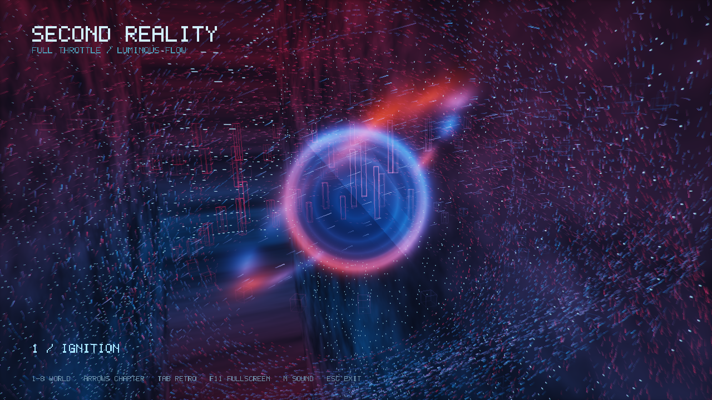
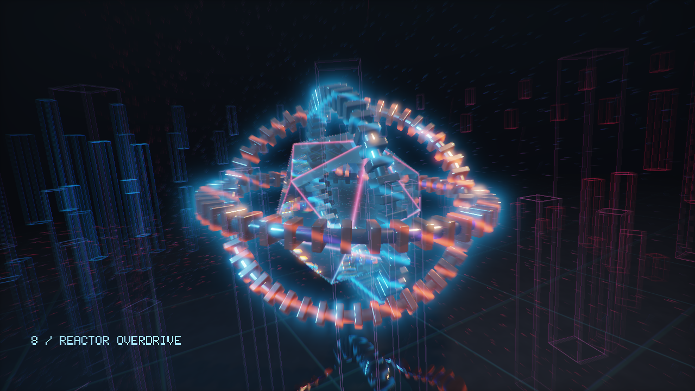

# Second Reality / Full Throttle

A standalone, music-driven realtime 3D demo for **Windows and Linux**. Eight procedural worlds, 31 chapters and the complete **7:52.36** soundtrack, *Luminous Flow*.

[4K60 full video](https://github.com/jojo-swe/SecondRealityRemix/releases/download/v0.2.0/SecondRealityRemix-4K60.mp4) · [Download v0.2.0](https://github.com/jojo-swe/SecondRealityRemix/releases/tag/v0.2.0) · [Swedish instructions](docs/README.sv.md) · [Verification](docs/VERIFICATION.md)



## Run

- **Windows:** download `SecondRealityRemix-Windows-x64.zip`, extract the entire archive and run `SecondRealityRemix.exe`. Keep `assets/` beside the executable. Windows 10/11 x64 and an OpenGL 3.3 driver are required; SDL and the MSVC runtime are statically linked.
- **Linux:** download `SecondRealityRemix-Linux-x64.tar.gz`, extract it and run `./SecondRealityRemix`. Built on Ubuntu 24.04 x64 with GCC 13 and glibc 2.39. Requires a working OpenGL driver and X11/Wayland. See [system dependencies and test limits](docs/VERIFICATION.md).

The demo starts at 1280×720 and loops the entire song. No account, network connection or development tools are needed to run it.

| Key | Action |
|---|---|
| F11 | Fullscreen / window |
| 1–8 | Jump to a world's first chapter, including its music position |
| Left / right arrow | Previous / next chapter |
| Tab | Modern / 320×200 retro rendering |
| M | Mute; animation and music clocks keep advancing |
| Esc | Exit |

## Music drives the animation

24 logarithmic FFT bands from **35 Hz to 18 kHz** independently animate geometry, material zones, lights and particle groups. Bass drives larger forms; midrange changes surface detail and ring structures; treble changes luminous trails. Four radial crowns of 24 wireframe spectrum columns surround the orbital scenes.

Analysis is precomputed from the included soundtrack at 20 Hz, smoothed with attack/release and interpolated using the audio playback clock. Seeking and muting preserve the animation position. No microphone or system audio is captured, and no fixed BPM is assumed. Chapter cuts are adjusted toward nearby measured transients.

## Eight worlds

| World | Main layers |
|---|---|
| Photon Corridor | Curved raymarched tunnel, 15,360 ring particles, neon ribs and velocity trails |
| Plasma / Gyroid | Perforated 3D sculpture, frequency-reactive veins, shadows, AO and floor reflections |
| Crystal Engine | Refractive faceted crystal, three GGX-lit metal gyroscopes, orbital trails and 3D spectrum |
| Neon City | Fast flights through repeated 3D buildings, reactive windows and neon tracks |
| Fracture Machine | Folded SDF architecture, pulsing gates and banking camera |
| Cosmic Reactor | Volumetric accretion disk, corona, nebula and 24,000 orbital trails |
| Quantum Ocean | Reactive waves, reflected sky, hovering spheres and aurora |
| Orbital Armada | Repeated 3D ships, wings, cockpits, engine light and flights through the fleet |

HDR buffers, bloom, bounded radial motion blur and subtle chromatic separation combine the layers. This uses OpenGL 3.3 rasterization, analytic ray intersections and SDF raymarching; it does not require hardware ray tracing. [Rendering details and approximations](docs/SOURCE_MAP.md).



## Build from source

The **release source bundle** `SecondRealityRemix-source.zip` includes the runtime WAV, original MP3 and generated analysis data. A Git checkout intentionally omits the large audio files: copy `assets/music/luminous-flow.wav` from a release package before running or testing it. Generated `src/music_data.hpp` is tracked.

SDL 3.4.18 is fetched from a pinned commit with a verified SHA-256. The first build needs network access, or set `FETCHCONTENT_SOURCE_DIR_SDL3` to an existing SDL source directory.

Windows, Visual Studio 2026 and CMake 3.25+:

```powershell
cmake --preset windows
cmake --build --preset windows
ctest --preset windows
./tools/smoke-test.ps1
./tools/package.ps1
```

Ubuntu 24.04:

```sh
sudo apt install build-essential cmake pkg-config libx11-dev libxext-dev libxrandr-dev libxcursor-dev libxi-dev libxfixes-dev libxss-dev libxtst-dev libwayland-dev libxkbcommon-dev libegl1-mesa-dev libgl1-mesa-dev libasound2-dev libpulse-dev
cmake --preset linux
cmake --build --preset linux
ctest --preset linux
build/linux/SecondRealityRemix --smoke-test --no-audio --capture-dir build/captures
bash tools/package.sh build/linux
```

Recreating audio and analysis with `tools/prepare_music.ps1` additionally needs ffmpeg and Python + numpy. Those tools are not runtime dependencies. Pass `-DREMIX_RUNTIME_TESTS=ON` when configuring to include the display-dependent control tests.

## Render a 4K video

The included Python tool renders the complete show at 3840x2160 and 60 fps with deterministic timestamps. It pipes RGB frames to ffmpeg, encodes H.264 using NVIDIA NVENC and muxes the soundtrack as 48 kHz AAC. This optional export tool needs Python, ffmpeg/ffprobe and a supported NVIDIA GPU. No intermediate image sequence is stored.

Run `python tools/render_video.py --app build/windows/Release/SecondRealityRemix.exe --output dist/SecondRealityRemix-4K60.mp4`. Short previews can use `--start 104 --duration 2`. The tool verifies resolution, frame count, frame rate and audio duration before finalizing the MP4.

The native `--render-stream --fps N` option writes bottom-up RGB24 to stdout with diagnostics on stderr. In this mode, `--duration` is timeline length rather than wall-clock runtime.

## Verification

The development build passed **4/4 CTest tests on Windows and on an isolated Linux Xvfb/Openbox display**. All eight worlds in both styles rendered without GL errors. Exact-time captures cover all 31 chapters; motion checks passed 31/31 on Windows NVIDIA/OpenGL and Linux WSLg NVIDIA/D3D12. Synthetic-tone tests check FFT frequency isolation.

Linux WSLg did not confirm the strict minimize lifecycle; its GPU rendering and the isolated display's lifecycle results are separate. A physical Linux desktop, subjective audiovisual synchronization, artistic quality and the musical loop seam still need human assessment. [Detailed evidence](docs/VERIFICATION.md).

For shader-only edits, manually copy `assets/` beside the built executable or install to a staging directory: the current POST_BUILD copy is not guaranteed to run after an asset-only change.

## Credits and licensing

- **Future Crew:** original *Second Reality* (1993), selected effect ideas and the 14-vertex / 24-triangle glenz geometry. [Original source](https://github.com/mtuomi/SecondReality), reference commit `071a82eddb7a7390dbaa491a8a473e0e923a55c2`, Unlicense/public domain. This is a selective reimagining, not a complete original-demo port or an official Future Crew release.
- **SDL:** zlib license, plus bundled dependency notices in `licenses/`.
- **New remix code:** [MIT](LICENSE).
- **Music:** *Luminous Flow*, artist metadata **joyolo**, generated with **Suno**, supplied by the project owner. Included in this free, non-commercial demo release at the owner's request. The music is **not MIT-licensed**; no commercial or additional redistribution rights are granted by this repository. See [music notice](licenses/MUSIC-NOTICE.txt), [provenance](music/asset-receipt.json) and [Suno's applicable terms](https://suno.com/terms-of-service).
