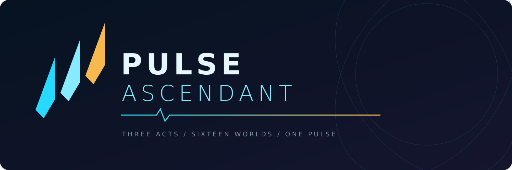
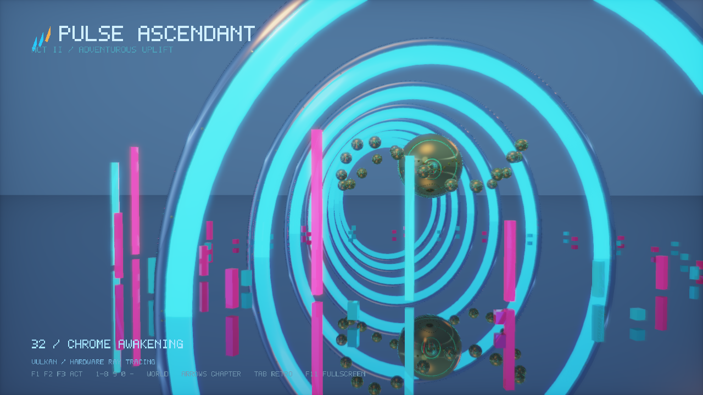
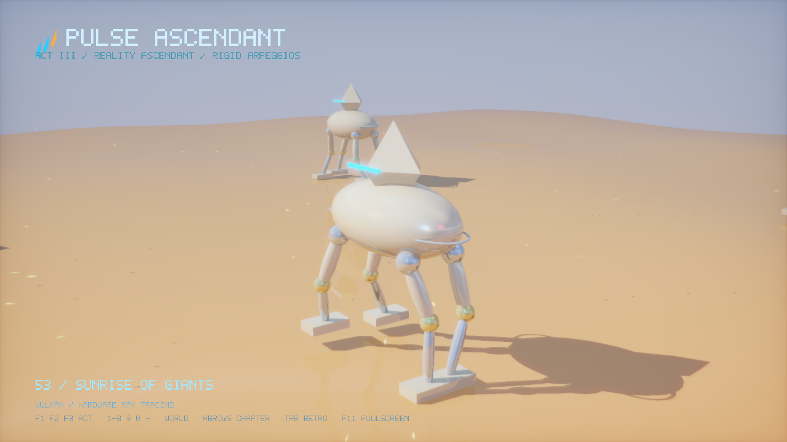
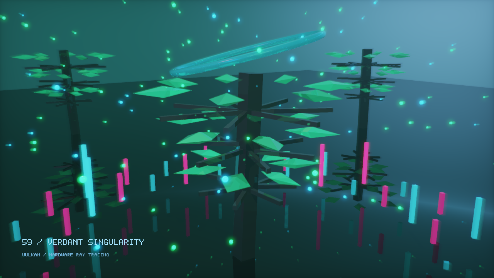
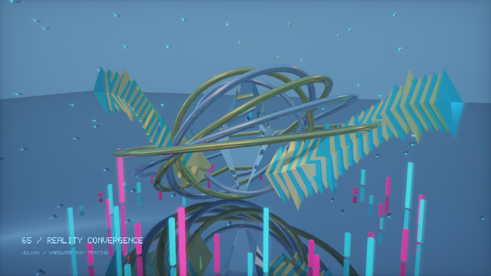

# Pulse Ascendant



A standalone, music-driven 3D demo for **Windows and Linux**: **three playable acts, 16 worlds, 76 chapters and 14:48.68 of music**. The first act transforms a selection of classic demoscene ideas; the next two introduce new worlds with Vulkan hardware ray tracing on supported GPUs.

[Releases](https://github.com/jojo-swe/PulseAscendant/releases/latest) · [32-second trailer](https://youtube.com/shorts/TYgXs76yKls) · [Swedish instructions](docs/README.sv.md) · [Rendering and provenance](docs/SOURCE_MAP.md) · [Verification](docs/VERIFICATION.md)

The three-act v0.3 implementation and Windows/Linux packages passed independent review at **7.3/10**. See the [review](docs/QUALITY_REVIEW.md) and verification document for measured results and acceptance limits; older releases and videos describe earlier versions.

## Run

- **Windows:** extract `PulseAscendant-Windows-x64.zip` and run `PulseAscendant.exe`. Keep the complete `assets/` directory beside it. Windows 10/11 x64 and an OpenGL 3.3 driver are required. SDL and the MSVC runtime are statically linked.
- **Linux:** extract `PulseAscendant-Linux-x64.tar.gz` and run `./PulseAscendant`. The build targets Ubuntu 24.04 x64, GCC 13 and glibc 2.39, with a working X11/Wayland display and OpenGL driver.

The demo starts at 1280×720 and loops the complete show. No account or network connection is required. Hardware tracing additionally needs a compatible Vulkan driver; unsupported devices use the separately implemented OpenGL fallback. An on-screen backend badge identifies the selected path.

| Key | Action |
| --- | --- |
| F1 / F2 / F3 | Jump to Act I / II / III, including its music |
| 1–8 | Act I worlds |
| 9 / 0 / - / = | Act II worlds |
| Q / W / E / R | Act III worlds |
| Left / right arrow | Previous / next chapter |
| Tab | Modern / 320×200 retro rendering |
| M | Mute; the music and animation clocks keep advancing |
| F11 | Fullscreen / window |
| Esc | Exit |

## Three acts

| Act | Music | Start | Length | Chapters |
| --- | --- | --- | --- | --- |
| I: Full Throttle | Luminous Flow, five-minute edit | 0:00 | 5:00 | 31 |
| II: Adventurous Uplift | Complete supplied song | 5:00 | 4:49.92 | 21 |
| III: Reality Ascendant | Rigid Arpeggios, complete supplied song | 9:49.92 | 4:58.76 | 24 |

All music plays at normal speed. Act I preserves the first 299 seconds of the decoded source sample for sample, followed by a one-second fade to its exact 300-second boundary. Acts II and III retain every decoded sample of their songs. A combined stereo 48 kHz PCM16 WAV supplies one continuous audio clock; both joins follow exact integer frame offsets.

| Act | Worlds |
| --- | --- |
| I | Photon Corridor · Plasma / Gyroid · Crystal Engine · Neon City · Fracture Machine · Cosmic Reactor · Quantum Ocean · Orbital Armada |
| II | Chrome Cathedral · Rain District · Orbital Foundry · Prism Chamber |
| III | Dune Colossus · Verdant Singularity · Gravity Rebellion · Reality Ascendant |

The first act combines tunnels, refractive facets, folded architecture, fleets, an ocean and orbital effects. Act II adds polished architecture, a wet city, articulated machinery and glass prisms. Act III introduces ceramic walkers in a desert, luminous vegetation, floating stone and a crystal-wing finale. [Act II](docs/ACT_II.md) and [Act III](docs/ACT_III.md) describe their implementations.

Actual native RT captures from the current build:

| Chrome Cathedral | Dune Colossus |
| --- | --- |
|  |  |
| Verdant Singularity | Reality Ascendant |
|  |  |

## Music and rendering

Each song has independent precomputed analysis: 24 logarithmic FFT bands from **35 Hz to 18 kHz**, bass, energy and onset curves, sampled at 20 Hz and interpolated against the audio transport. Different bands drive geometry, lighting, surfaces and particle groups. Chapter direction considers measured attacks and persistent spectral changes within ±2.5 seconds of editorial targets, with 5–18 second chapter bounds and no assumed BPM. This improves cut placement; subjective musical synchronization still needs listening.

Acts II and III can use **Vulkan KHR ray queries against triangle BLAS/TLAS**. Five reusable meshes form animated scenes within a 2,048-instance budget. Shadows, reflections and refraction use bounded ray traversal with up to five surface encounters. Modern RT rendering uses two deterministic subpixel samples plus an adaptive edge filter; retro uses one sample per pixel. OpenGL presents the HDR image and composes bloom, effects and captions.

The RT output passes from a Vulkan device-local buffer through host readback to an OpenGL HDR texture each frame. This is not zero-copy interoperability. The renderer is not a full path tracer and does not provide general global illumination or temporal denoising. Resolution and scene complexity affect performance; **a 4K60 export is not an interactive 4K60 guarantee**.

OpenGL 3.3 also provides a separate SDF/analytic fallback for all 16 worlds. Use `--no-rt` to select it deliberately, `--require-rt` to fail if the RT backend cannot initialize, and `--rt-validation` for Vulkan diagnostics where validation layers are installed. Act I uses its OpenGL renderer in either configuration.

## Build from source

The release source bundle, `PulseAscendant-source.zip`, includes all three original MP3s, three per-act runtime WAVs, the combined WAV and generated analysis. A Git checkout intentionally omits audio. Restore **all four WAVs** before running the full checks: CTest reads Act I and the combined show, while the standalone audio checks also compare Acts II and III. Runtime binary packages include only `assets/music/second-reality-three-acts.wav`; copying that file alone is insufficient for full source validation.

SDL 3.4.18 is fetched from a pinned commit with a verified SHA-256. Vulkan headers are located from the SDK or fetched from a pinned release. The normal executable loads Vulkan dynamically and can start in fallback mode without a Vulkan loader. A runtime shader compiler is not required because compiled SPIR-V ships with the assets.

Windows, Visual Studio 2026 and CMake 3.25+:

```powershell
cmake --preset windows
cmake --build --preset windows
ctest --preset windows
./tools/package.ps1
```

Ubuntu 24.04:

```sh
sudo apt install build-essential cmake pkg-config libx11-dev libxext-dev libxrandr-dev libxcursor-dev libxi-dev libxfixes-dev libxss-dev libxtst-dev libwayland-dev libxkbcommon-dev libegl1-mesa-dev libgl1-mesa-dev libasound2-dev libpulse-dev
cmake --preset linux
cmake --build --preset linux
ctest --preset linux
bash tools/package.sh build/linux
```

For offline dependency reuse, configure with `-DFETCHCONTENT_SOURCE_DIR_SDL3=/path/to/SDL` and a local Vulkan header include path via `REMIX_VULKAN_INCLUDE_DIR`. Add `-DREMIX_RUNTIME_TESTS=ON` to register tests that require a working display. For shader-only edits, copy the updated assets beside the executable or install to staging; the executable's POST_BUILD step may not run after an asset-only change.

To recreate audio, FFT data and directed cues, install ffmpeg, Python and numpy, then run:

```sh
python tools/prepare_show.py "Luminous Flow.mp3" "Adventurous Uplift.mp3" "Rigid Arpeggios.mp3"
```

The script checks source hashes, prepares the three runtime tracks, combines them without gaps and regenerates per-act analysis and cue direction. With the original files already under `music/source/`, it also works without arguments. The PowerShell entry point is `tools/prepare_music.ps1`.

After editing the Vulkan compute shader, rebuild and validate its shipped SPIR-V with Vulkan SDK tools:

```sh
glslangValidator -V -Os --target-env vulkan1.2 assets/shaders/rt_scene.comp -o assets/shaders/rt_scene.comp.spv
spirv-val --target-env vulkan1.2 assets/shaders/rt_scene.comp.spv
```

## Capture and export

`PulseAscendant --show-info` prints the three acts, measured durations, audio asset and all 76 directed chapter starts as JSON without initializing a display.

```powershell
build/windows/Release/PulseAscendant.exe --smoke-test --no-audio --capture-dir build/captures
build/windows/Release/PulseAscendant.exe --tour-test --no-audio --capture-dir build/tour
python tools/verify-motion.py build/tour build/motion.json
python tools/render_video.py --app build/windows/Release/PulseAscendant.exe --require-rt --output dist/three-acts/PulseAscendant-4K60.mp4
```

Smoke mode requests all 16 worlds in both styles; tour mode requests two exact-time captures per chapter. Capture success and image motion are separate from artistic acceptance. See [current evidence](docs/VERIFICATION.md).

Additional audio and music-direction checks need the complete source audio plus Python and numpy:

```powershell
python tests/test_show.py --app build/windows/Release/PulseAscendant.exe
python tests/test_music_analysis.py
python tests/test_music_direction.py
```

The exporter reads `--show-info`, checks the combined music's format and sample count, rejects ranges outside 888.68 seconds, and validates the encoded resolution, frame count, frame rate and audio duration. It needs Python, ffmpeg/ffprobe and NVIDIA H.264 NVENC. A short preview can add `--start 589.92 --duration 5`. Existing outputs are protected; choose a new filename for another render. Packages are written under `dist/three-acts/`.

The native `--render-stream --fps N` option writes bottom-up RGB24 to stdout and diagnostics to stderr. In this mode, `--duration` is timeline length, not wall-clock runtime.

`tools/render_short.py --app <executable> --font <bold.ttf> --output <new.mp4>` creates a 32-second 1080×1920/60 trailer from seven native camera excerpts. It places montage cuts on measured Act III music attacks, constrains every segment to its five-second source, and identifies cached renders by SHA-256 of the executable and its assets. Trailer revision 2 removes a weak city-camera excerpt following visual review. It uses a 70–102 s excerpt of Rigid Arpeggios; the full demo retains the complete three-act audio. The original v0.3.0 source archive preserves trailer revision 1; current Git source and the separate trailer-v2 source supplement contain the updated generator.

## Credits and licensing

**Pulse Ascendant** has its own identity and new choreography. Its history includes a selective reimagining of Future Crew's *Second Reality* (1993). Future Crew receives credit for the original demo, selected effect ideas and the 14-vertex / 24-triangle glenz geometry. [Original source](https://github.com/mtuomi/SecondReality), reference commit `071a82eddb7a7390dbaa491a8a473e0e923a55c2`, Unlicense/public domain. This is not an official Future Crew release or a complete port. The original source and prior releases remain preserved.

Khronos Vulkan headers carry Apache-2.0 and MIT notices; the applicable notices and Apache license text are bundled under `licenses/`.

New code uses the [MIT license](LICENSE); SDL uses its zlib license and bundled notices. **Music is not MIT-licensed.** Luminous Flow, Adventurous Uplift and Rigid Arpeggios were generated with Suno, carry artist metadata **joyolo**, and were supplied and requested for publication by the project owner. Their applicable rights remain separate. See [music credits and source hashes](licenses/MUSIC-NOTICE.txt), the receipts in `music/`, and [Suno's terms](https://suno.com/terms-of-service).
