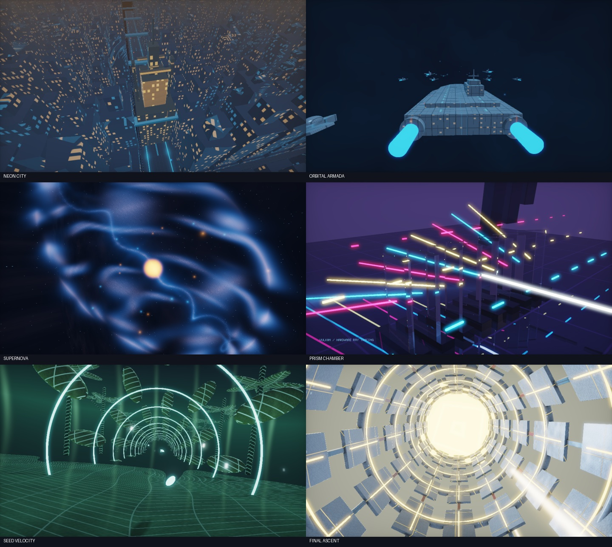

<div align="center">


### Följ pulsen. Flyg genom sexton världar.

[](https://github.com/jojo-swe/PulseAscendant/releases/tag/v0.5.0)
[](#kör)

**[Ladda ned](https://github.com/jojo-swe/PulseAscendant/releases/tag/v0.5.0)** · **[Se förhandsvisningen](https://github.com/jojo-swe/PulseAscendant/releases/download/v0.5.0/PulseAscendant-Preview-1080p60.mp4)** · **[English](../README.md)**

</div>

Ett fristående musikdrivet 3D-demo för **Windows och Linux**: **tre spelbara akter, 16 världar, 76 kapitel och 14:48,68 musik**. Varje återkomst till en värld har nu eget scenförlopp. Akt II använder Vulkan-hårdvaruraytracing på kompatibla grafikkort; akt I och III använder procedurala OpenGL-världar.

[Se förhandsvisningen i 1080p60](https://github.com/jojo-swe/PulseAscendant/releases/download/v0.5.0/PulseAscendant-Preview-1080p60.mp4) · [Ladda ned v0.5](https://github.com/jojo-swe/PulseAscendant/releases/tag/v0.5.0) · [Trailer från v0.4](https://youtube.com/shorts/uOhjmoLY6DI) · [Föregående fullvideo (v0.3)](https://youtu.be/b5ShsKNC7KM) · [Teknisk källkarta](SOURCE_MAP.md) · [Aktuell verifiering](VERIFICATION.md)

**v0.5: mer fart och tydligare musikreaktion.** Snabbare kameror, separata bas-/mellanregister-/diskantanslag vid 100 Hz, arbetande maskindelar och trafik samt tydligare stad, flotta och kosmiska strukturer. Interaktiv grafik och export använder samma analyserade musikvärden. `--pulse-gain 1.5` förstärker impulserna; standard 1, intervall 0–2. Den tidigare trailern visar v0.4 och fullvideon v0.3. Hela v0.5-filmen är nu exporterad och verifierad i 4K60. YouTube-publiceringen återstår efter den tidigare uppladdningsgränsen. Se [förbättringarna](ENERGY_REWORK.md) och [verifieringen](VERIFICATION.md).

[](https://github.com/jojo-swe/PulseAscendant/releases/download/v0.5.0/PulseAscendant-Preview-1080p60.mp4)

<p align="center"><sub>Bilder direkt från demot. Klicka för 2:40,75 förhandsvisning med originalmusiken.</sub></p>

## Kör

**Windows:** packa upp hela `PulseAscendant-Windows-x64.zip` och starta `PulseAscendant.exe`. Behåll `assets/` bredvid programmet. Windows 10/11 x64 och en OpenGL 3.3-drivrutin krävs. SDL och MSVC-runtime är statiskt länkade.

**Linux:** packa upp `PulseAscendant-Linux-x64.tar.gz` och kör `./PulseAscendant`. Bygget riktar sig till Ubuntu 24.04 x64, glibc 2.39 och GCC 13:s libstdc++, med X11/Wayland och OpenGL-drivrutin.

Programmet startar i 1280×720 och loopar hela demot. Konto och nätverk behövs inte. Vulkan-RT kräver dessutom en kompatibel drivrutin; annars väljs OpenGL-reserven. En synlig märkning visar renderingsvägen.

| Tangent | Funktion |
| --- | --- |
| F1 / F2 / F3 | Hoppa till akt I / II / III med motsvarande musik |
| 1–8 | Akt I:s åtta världar |
| 9 / 0 / - / = | Akt II:s fyra världar |
| Q / W / E / R | Akt III:s fyra världar |
| Vänster / höger pil | Föregående / nästa kapitel |
| Tab | Modern / retro i 320×200 |
| M | Ljud av/på; tidslinjen fortsätter |
| F11 | Helskärm / fönster |
| Esc | Avsluta |

## Musik och akter

| Akt | Låt | Start | Längd | Kapitel |
| --- | --- | --- | --- | --- |
| I: Full Throttle | Luminous Flow, femminutersklipp | 0:00 | 5:00 | 31 |
| II: Adventurous Uplift | Hela låten | 5:00 | 4:49,92 | 21 |
| III: Reality Ascendant | Hela Rigid Arpeggios | 9:49,92 | 4:58,76 | 24 |

Musiken spelas i normal hastighet. De första 299 sekunderna i akt I är sampleidentiska med den avkodade källan; sista sekunden tonas ut fram till exakt 300 sekunder. Akt II och III använder alla avkodade samplingar. Ett sammanfogat PCM16-ljudspår i stereo, 48 kHz, ger en gemensam uppspelningsklocka och sampleexakta aktgränser.

Varje låt har egen FFT-analys med 24 logaritmiska frekvensband mellan 35 Hz och 18 kHz. Kurvorna analyseras vid 20 Hz och interpoleras vid aktuell ljudposition. Bas, mellanregister, diskant och anslag styr olika objekt, material, ljus och partiklar samtidigt. Inget mikrofon- eller systemljud spelas in.

Scenbyten väljs med uppmätta anslag och bestående spektrala förändringar inom ±2,5 sekunder från redaktionella mål. Kapitlen begränsas till 5–18 sekunder; ingen fast BPM antas. Varje kapitel får en sammanhängande kameraväg och en separat huvudhändelse på en uppmätt accent. Upplevd musikalisk synk behöver bedömas genom lyssning, separat från analysen.

Akt I rymmer tunnlar, kristaller, stad, vikta maskiner, reaktor, hav och rymdflotta. Akt II tillför kromkatedral, regnstad, orbital fabrik och prismakammare. Akt III tillför ökenkolosser, lysande växtarkitektur, flytande sten och en kristallvingad final. Se [akt II](ACT_II.md) och [akt III](ACT_III.md).

## Renderingsvägar

Vulkan-renderaren för akt II använder riktiga KHR-ray queries mot triangel-BLAS och en dynamisk TLAS. Fem grundmesh används inom en budget på 2 048 instanser. Strålar ger skuggor, reflektioner och brytning med högst fem ytträffar. Modern RT använder två deterministiska subpixelprover och ett adaptivt kantfilter; retro använder ett prov per pixel.

Resultatet kopieras från Vulkan-enhetsminne via värdminne till en OpenGL-HDR-textur varje bild. Det är inte zero-copy. Renderaren är ingen fullständig path tracer och ger ingen allmän global illumination eller temporal denoising. En exporterad 4K60-video innebär inte garanterade 60 interaktiva bilder per sekund i 4K.

OpenGL 3.3 kör akt I och III samt en separat reserv för akt II. Välj `--no-rt` för reserven, `--require-rt` för att kräva tillgänglig Vulkan-RT och `--rt-validation` för Vulkan-diagnostik där valideringslagren finns. Akt I och III använder alltid OpenGL.

## Bygg och återskapa ljud

Källarkivet `PulseAscendant-source.zip` innehåller alla tre original-MP3, tre akt-WAV, den sammanfogade WAV-filen och genererad analys. Git ignorerar ljudet. Ett Git-utcheck behöver **alla fyra WAV-filer** för hela testsviten; runtimepaketet innehåller endast `second-reality-three-acts.wav`.

CTest läser akt I och den sammanfogade filen. De separata Python-kontrollerna jämför även akt II och III samt källornas hashar. Med Python och numpy kan de köras som `python tests/test_show.py --app build/windows/Release/PulseAscendant.exe`, `python tests/test_music_analysis.py` och `python tests/test_music_direction.py`.

Windows med Visual Studio 2026 och CMake 3.25+:

```powershell
cmake --preset windows
cmake --build --preset windows
ctest --preset windows
./tools/package.ps1
```

Ubuntu 24.04:

```sh
sudo apt install build-essential cmake pkg-config libx11-dev libxext-dev libxrandr-dev libxcursor-dev libxi-dev libxfixes-dev libxss-dev libxtst-dev libwayland-dev libxkbcommon-dev libegl1-mesa-dev libgl1-mesa-dev libasound2-dev libpulse-dev
cmake --preset linux
cmake --build --preset linux
ctest --preset linux
bash tools/package.sh build/linux
```

SDL hämtas från en låst commit med verifierad hash. Vulkan-headerfiler hittas lokalt eller hämtas från en låst release. Vulkan laddas dynamiskt; reservvägen kan starta utan Vulkan-loader. Se [engelsk bygginformation](../README.md) för lokal återanvändning av beroenden och SPIR-V-kompilering.

Ljud, analys och musikstyrda klipp återskapas med ffmpeg, Python och numpy:

```sh
python tools/prepare_show.py "Luminous Flow.mp3" "Adventurous Uplift.mp3" "Rigid Arpeggios.mp3"
```

Utan argument används originalfilerna under `music/source/`. PowerShell-ingången är `tools/prepare_music.ps1`. Dessa verktyg behövs inte för att spela upp det färdiga demot.

## Diagnostik och export

Interaktiv uppspelning förbereder grafikprogrammen före musikstart. Fönstertiteln visar framsteg; på WSLg kan detta ta över en minut beroende på drivrutin. Escape avbryter. Förberedelsen hindrar drivrutinens första shaderkörning från att förbruka musikens inledning.

```powershell
build/windows/Release/PulseAscendant.exe --show-info
build/windows/Release/PulseAscendant.exe --smoke-test --no-audio --capture-dir build/captures
build/windows/Release/PulseAscendant.exe --tour-test --no-audio --capture-dir build/tour
python tools/storyboard.py --help
python tools/render_video.py --app build/windows/Release/PulseAscendant.exe --require-rt --output dist/three-acts/PulseAscendant-4K60.mp4
```

Smoke-läget begär alla 16 världar i två stilar. Tour-läget fångar 18% och 82% genom varje kapitel. `storyboard.py` grupperar bilderna för granskning. Trösklarna i äldre `verify-motion.py` utgår från tidigare fångsttider och är ingen acceptansgräns för v0.4. Bildförändring är inget betyg på konstnärlig kvalitet. Lägg till `-DREMIX_RUNTIME_TESTS=ON` vid konfigurering för displayberoende kontrolltester.

Exportören läser programmets `--show-info`, kontrollerar ljudets format och sampleantal samt tillåter endast intervall inom 888,68 sekunder. Den behöver ffmpeg/ffprobe och NVIDIA NVENC. För en kort akt III-förhandsvisning kan `--start 589.92 --duration 5` läggas till. Paket och ny export placeras under `dist/three-acts/`.

CMake synkroniserar `assets/` till programkatalogen även när bara shaders har ändrats. Aktuell native-, Linux-, RT-, fallback- och kvalitetsacceptans dokumenteras i [VERIFICATION.md](VERIFICATION.md); historiska provresultat gäller inte automatiskt den nya versionen.

## Krediter

Pulse Ascendant har en egen identitet och ny koreografi. Projektets historia omfattar en selektiv omarbetning av Future Crews **Second Reality** (1993). Originaldemo, utvalda effektidéer och glenz-geometri krediteras Future Crew. [Originalkälla](https://github.com/mtuomi/SecondReality), commit `071a82eddb7a7390dbaa491a8a473e0e923a55c2`, public domain/Unlicense. Originalträdet och tidigare releaser är bevarade.

Ny kod: MIT. SDL: zlib och medföljande licenstexter. De tre Suno-låtarna, artistmetadata **joyolo**, levererades av projektägaren och ingår på dennes begäran. Musiken omfattas inte av MIT. [Musikkrediter, Suno-ID och källhashar](../licenses/MUSIC-NOTICE.txt).
